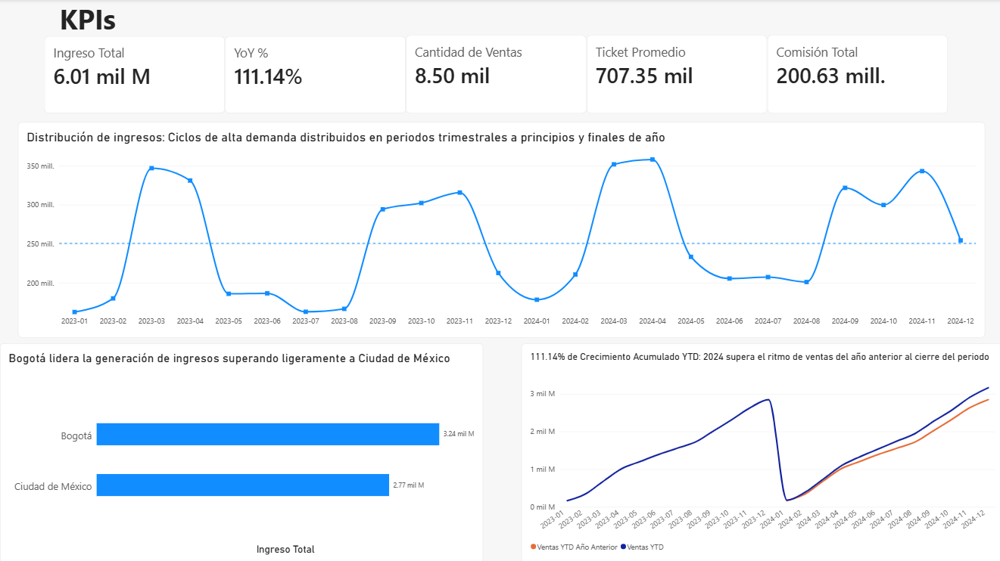
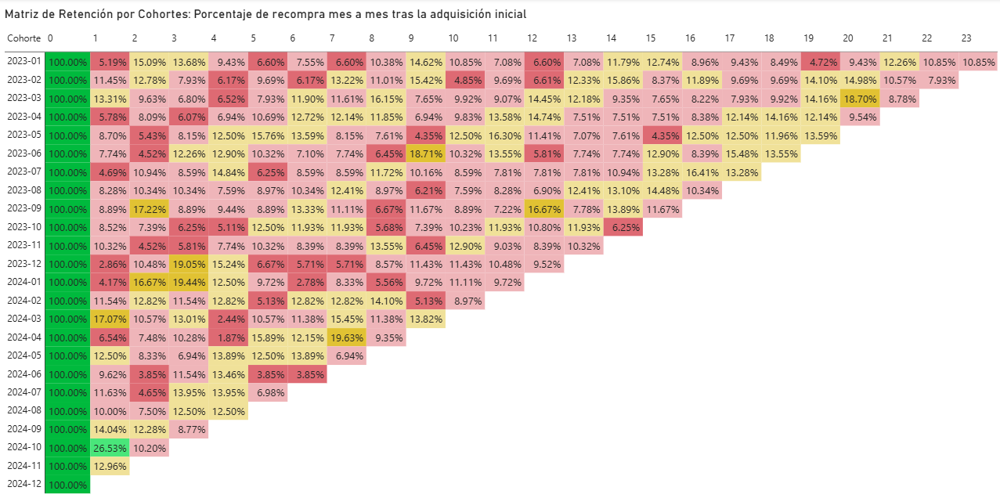

# Andes Capital Commercial and Cohort Analysis – Sprint 11

Este repositorio contiene un proyecto avanzado de Inteligencia de Negocios y Analítica Comercial desarrollado para el **Sector Inmobiliario**. El objetivo principal es evaluar el desempeño financiero y el comportamiento de recompra de los clientes mediante la construcción de un modelo relacional estrella en **Power BI**, la implementación de métricas financieras en **DAX** (Inteligencia de Tiempo y participación de mercado) y el desarrollo de un **Análisis de Cohortes** para medir la retención.

## Contenido del repositorio

* `Andes_Capital_Dashboard.pbix`: Archivo principal de Power BI que contiene el modelo relacional estrella, las medidas DAX optimizadas (YTD, YoY) y las pestañas del dashboard ejecutivo e interactivo.
* `Proyect_Sprint11_InmobiliarioGrupoAndes.ipynb`: Jupyter Notebook principal que documenta el pipeline de preparación de datos, la gestión de tipos de datos, la creación de columnas de cohorte en Python y las justificaciones del negocio.

---

## 🖼️ Vista Previa del Dashboard

### Vista 1: Overview Ejecutivo

### Vista 2: Análisis de Cohortes y Retención de Clientes

---

## 🎯 Estructura del Modelo y Objetivos Analíticos

* **Modelado en Estrella (Schema):** Construcción de un modelo relacional óptimo conectando la tabla central de hechos (`hecho_ventas_propiedades`) con las dimensiones de negocio (`dim_clientes`, `dim_propiedades`) y una tabla calendario dinámica (`dim_fecha`) mediante relaciones uno a muchos (1:*) con dirección de filtro simple.
* **Métricas Base y Contexto de Filtro:** Implementación de expresiones DAX con control de contexto (`CALCULATE` y `ALL`) para evaluar la participación porcentual de ingresos por tipo de propiedad, canal de venta y segmento de cliente.
* **Inteligencia de Tiempo:** Desarrollo de cálculos avanzados de negocio para medir el acumulado anual actual (**YTD**), el rendimiento del año anterior y la tasa de crecimiento interanual (**YoY**).
* **Análisis de Cohortes (Retention):** Creación de columnas calculadas cronológicas para agrupar a los clientes según su mes de adquisición y mapear dinámicamente su comportamiento de recompra a lo largo del tiempo.

## 📈 Hallazgos Estadísticos y Decisiones de Negocio (Findings)

* **Salud Financiera General:** El negocio demuestra una sólida posición comercial durante el periodo analizado, consolidando un **Ingreso Total de \$6,010 Millones** a través de **8,500 transacciones de venta**, con un ticket promedio por propiedad de **\$707,350** y una recaudación por comisiones de **\$200.63 Millones**.
* **Estructura del Portafolio e Ingresos:** Las propiedades tipo **Casa** lideran la generación de *revenue* con **\$2,240 Millones**, seguidas de cerca por el sector Comercial (\$1,920 Millones) y Departamentos (\$1,850 Millones). Esto evidencia un portafolio equilibrado donde ninguna categoría canibaliza el negocio.
* **Eficiencia de Canales y Segmentos:** El canal de **Corredores** es el motor absoluto de conversión de la empresa, concentrando **\$4,400 Millones** del ingreso frente al canal directo. Asimismo, el segmento de clientes **Compradores de Primera Vez** representa el núcleo del negocio con **\$3,800 Millones**, superando masivamente a los inversionistas tradicionales.
* **Crecimiento e Inteligencia Temporal:** El negocio experimenta una aceleración comercial agresiva, registrando un **Crecimiento Interanual (YoY) del 111.14%**, lo que confirma que las estrategias comerciales actuales están duplicando el ritmo del año anterior al cierre del periodo.
* **Comportamiento de Cohortes (Recompra):** El análisis de cohortes identifica que los clientes adquiridos a inicios de los ciclos **2023 y 2024** presentan los mayores índices de lealtad y recurrencia de compra, mientras que las cohortes más recientes muestran una desaceleración en su ciclo de vida.

## 🚀 Recomendaciones Estratégicas

1. **Optimización de Canales:** Robustecer las alianzas y comisiones con el canal de Corredores debido a su alta eficiencia y peso en la facturación masiva.
2. **Estrategia de Retención:** Implementar un programa de fidelización y ofertas exclusivas de actualización de portafolio dirigidas a las cohortes recientes para forzar la recompra e igualar el comportamiento de las cohortes de 2023.
